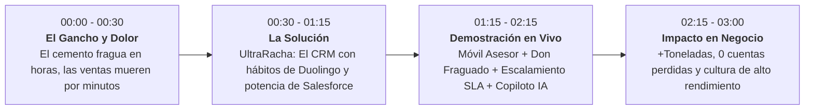

# Pitch Deck Ejecutivo: UltraRacha (CRM Gamificado & Copiloto Comercial Ultracem)

**Proyecto:** Reto Bootcamp Semillero By Cooweb — Día 1  
**Tiempo estimado de presentación:** 3 minutos (Elevator Pitch Comercial B2B)  
**Audiencia:** Directivos Comerciales de Ultracem, Mentores y Jurado de Cooweb  

---

## Estructura del Pitch en 3 Minutos

---

### Minuto 00:00 - 00:30 | El Gancho y el Gran Dolor
> *"Buenas tardes directivos y mentores. En la industria de materiales de construcción, hay una regla universal: **el concreto no espera a nadie**. Si un camión mixer se retrasa 30 minutos, la mezcla se echa a perder. Pero en el área comercial pasa exactamente lo mismo: **un día que un asesor tarde en llamar a una ferretería o a una obra, es un pedido de 50 toneladas que se va para la competencia.**
> 
> Hoy en Ultracem, los asesores comerciales están en el calor de la obra, esquivando polvo y recibiendo llamadas. Documentar en un CRM tradicional es engorroso, y los supervisores solo descubren que una cuenta se perdió cuando ya es demasiado tarde. ¿El resultado? Cotizaciones vencidas, toneladas perdidas y disputas entre ventas, cartera y logística."*

---

### Minuto 00:30 - 01:15 | La Solución: UltraRacha
> *"Por eso creamos **UltraRacha**: el primer CRM gamificado asistido por IA diseñado exclusivamente para la fuerza comercial de Ultracem.
> 
> Tomamos la psicología de hábitos de Duolingo y la robustez de Salesforce para transformar la disciplina de ventas en un juego de alto rendimiento. Nuestra premisa es simple: **'Que el cemento fragüe, pero que tu cliente nunca se enfríe'**.
> 
> Cada asesor tiene un contador de racha diaria. Para mantener su fuego encendido, antes de las 11:59 PM debe haber atendido al 100% de sus cuentas en **Riesgo Crítico**. Y aquí está la genialidad: si el cliente no contesta o está bloqueado por crédito o despacho, **el asesor no es castigado; puede escalar el caso en 1 clic a Cartera, Logística o Calidad**, protegiendo su racha y activando un temporizador con SLA interno."*

---

### Minuto 01:15 - 02:15 | El Producto en Acción (Demostración)
> *(Mostrando la pantalla interactiva de UltraRacha)*
> 
> 1. **En el Móvil del Asesor:**
>    - *"Aquí vemos a Carlos Mendoza, asesor en Barranquilla con **21 días de racha activa 🔥**. Su reloj le recuerda que el corte es a las 11:59 PM."*
>    - *"Nuestra mascota, **Don Fraguado** —el saco de cemento con casco de ingeniero— le alerta en tiempo real: '¡Carlos, Constructora Bolívar tiene una cotización de 120 toneladas a punto de vencer hoy!'."*
>    - *"Con nuestro **Copiloto IA**, Carlos no pierde 20 minutos redactando. La IA genera la minuta formal, extrae los datos de resistencia de la **Ficha Técnica Oficial NTC 121 de Cemento Estructural**, y le redacta el mensaje de WhatsApp listo para enviar."*
>    - *"¿Y si el cliente pide liberación de cupo? Carlos presiona **'Escalar a Cartera'**, el sistema asigna un SLA de 4 horas, ¡y su racha sube a **22 días** con celebración inmediata!"*
> 
> 2. **En la Pantalla del Supervisor:**
>    - *"El Líder Comercial no persigue vendedores con hojas de cálculo. Abre su **Dashboard Web** y ve la 'Liga Maestros Ultracem', el mapa de calor de toneladas (3,420 Ton este mes) y una bandeja de auditoría donde sabe exactamente qué departamento tiene frenada una venta."*

---

### Minuto 02:15 - 03:00 | Tracción, Impacto y Cierre
> *"Con UltraRacha logramos tres impactos inmediatos:
> 
> 1. **Cero cuentas en el olvido:** Reducción del 85% en cotizaciones vencidas sin seguimiento.
> 2. **Sinergia Operativa:** Logística y Cartera ahora tienen métricas claras de cómo su velocidad de respuesta afecta las toneladas vendidas.
> 3. **Cultura de Ganadores:** Vendedores orgullosos compitiendo sanamente y superando su cuota mes a mes.
> 
> Señores de Ultracem: la infraestructura del país se construye con su cemento; la solidez de sus ventas a partir de hoy se construye con **UltraRacha**. Muchas gracias."*

---

## Preguntas Frecuentes del Jurado (Q&A de Defensa)

| Pregunta Posible del Jurado | Respuesta Estratégica |
| :--- | :--- |
| **¿Qué pasa los fines de semana o cuando el vendedor está incapacitado?** | Contamos con la regla de **'Fraguado Seguro'**: los domingos y festivos la racha se congela automáticamente (o da x1.5 puntos si gestiona voluntariamente). Además, cada 7 días de racha consecutiva, el asesor gana un **'Casco Protector'** que puede activar para proteger su racha 24h ante emergencias o viajes sin señal. |
| **¿Cómo aseguramos que el asesor no invente gestiones falsas solo por salvar la racha?** | El sistema audita la trazabilidad: cada llamada o mensaje genera minutas que el cliente valida indirectamente al contestar o al quedar asignado un ticket a un departamento real (Cartera o Logística). El supervisor tiene alertas de patrones sospechosos. |
| **¿Por qué gamificación en un sector tradicional como el cementero?** | Porque el vendedor de campo vive de la motivación y la inmediatez. Las metas mensuales a 30 días se sienten lejanas; la **racha diaria de 24 horas** genera sentido de urgencia inmediato cada mañana. |
