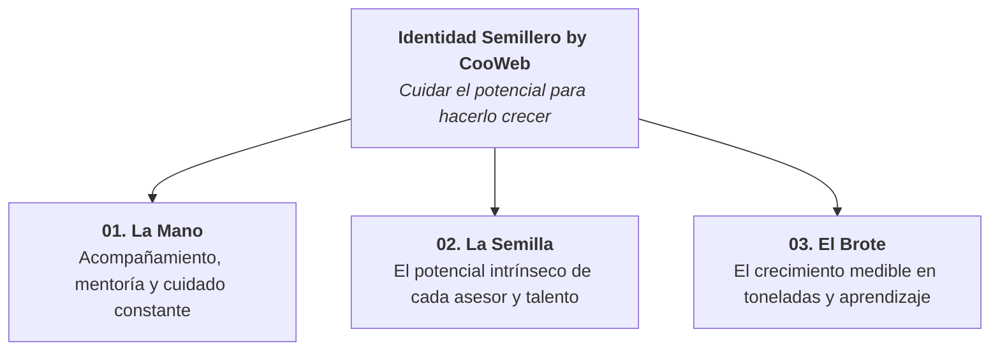
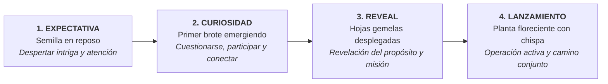
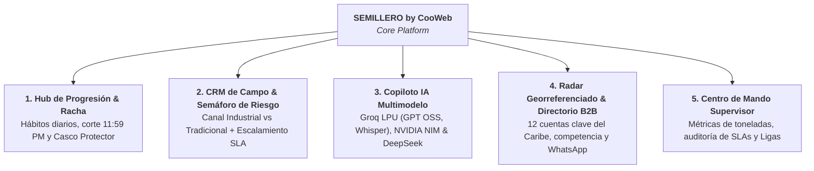

# PRD Maestro: Semillero by CooWeb
## Plataforma de Aceleración de Talento, CRM de Campo Gamificado & Copiloto IA

> **Marca:** SEMILLERO by CooWeb  
> **Lema Institucional:** *"Cuidar el potencial para hacerlo crecer."*  
> **Aliado Estratégico / Caso de Uso:** Ultracem S.A.S. (Líder en Cemento & Concreto)  
> **Versión del Documento:** 1.0 (Producción & Demo Activa)  
> **Fecha:** Octubre 2026  
> **Estado:** Aprobado para Implementación & Despliegue de Demo  

---

## 1. Visión del Producto y Filosofía de Marca

### 1.1. Propósito y Esencia
**Semillero by CooWeb** no es un programa aislado ni un software administrativo convencional: **es un ecosistema de crecimiento profesional continuo** que cuida el talento humano desde su etapa de germinación hasta convertirlo en una fuerza de alto rendimiento.

En entornos industriales y comerciales de alta exigencia (como la comercialización de cemento y concreto con **Ultracem**), el éxito depende de la constancia diaria, la agilidad técnica y la eliminación de fricciones operativas. Semillero combina:
1. **La confianza y tecnología que respalda a CooWeb.**
2. **La energía, cercanía y crecimiento orgánico de Semillero.**
3. **La psicología de hábitos y gamificación de alto impacto** (*"Que el cemento fragüe, pero que tu cliente y tu talento nunca se enfríen"*).

---

## 2. Sistema de Identidad Visual y Diseño (Brand Book Oficial)

El diseño de la aplicación respeta con absoluta rigurosidad el manual de identidad y evolución de marca de **Semillero by CooWeb**:

### 2.1. Anatomía del Logotipo
* **La Mano:** Trazos envolventes que representan la protección y el acompañamiento activo del equipo de líderes y mentores.
* **La Semilla:** Núcleo geométrico que simboliza el punto de partida y la energía latente de cada miembro de la organización.
* **El Brote:** Hojas orgánicas que emergen hacia arriba, representando el avance de nivel, las rachas comerciales ganadas y las toneladas despachadas.

### 2.2. Paleta Cromática Oficial y Jerarquía Semántica

| Rol Semántico | Nombre de Color | Código HEX | Función en la Interfaz |
| :--- | :--- | :--- | :--- |
| **Base / Autoridad** | **Semillero Navy** | `#0F172A` | Títulos principales, contornos de autoridad, sombras de elevación, fondos B2B y textos de máxima legibilidad. |
| **Primario / Acción** | **Semillero Teal** | `#14B8A6` | Botones de llamada a la acción (CTA), momentos de marca, navegación activa, brotes y confirmaciones de crecimiento. |
| **Expansión** | **Mint Teal** | `#5EEAD4` | Tarjetas de nivel, superficies de comunidad, badges de progreso e ilustraciones luminosas. |
| **Secundario** | **Sky Blue** | `#7DD3FC` | Diversidad de módulos, micro-interacciones, contenido educativo y contadores de tiempo. |
| **Secundario Claro** | **Soft Sky** | `#BAE6FD` | Fondos de tarjetas informativas, contenedores de audio y piezas de lectura amigable. |
| **Superficie General** | **Cloud Slate** | `#F1F5F9` | Fondo estructural principal de la aplicación móvil y el panel web. |
| **Endorsement** | **CooWeb Blue** | `#3797E8` | Vínculo de respaldo con la empresa matriz (`by cooweb`); convive en armonía sin competir con el Teal de Semillero. |

### 2.3. Elementos Gráficos de Soporte
* **Tarjetas Orgánicas:** Esquinas generosamente redondeadas (`border-radius: 18px a 24px`), bordes finos de 1px en `#E2E8F0` y sombras de elevación suaves.
* **Hojas y Brotes:** Micro-iconografía vegetal que reemplaza indicadores genéricos para medir el progreso de la racha diaria.
* **Matriz de Puntos (Dot Matrix):** Acentos sutiles en esquinas que refuerzan la precisión tecnológica de CooWeb.
* **Trazos Fluidos:** Líneas onduladas que conectan etapas en la línea de tiempo de los clientes.
* **Copys de Esencia:**
  * *"Crecemos juntos"* 🌱
  * *"Aprende, crece y construye tu futuro"*
  * *"Tu potencial nos impulsa"* ✨

---

## 3. Estrategia de Activación en 4 Etapas

Para garantizar que la adopción de la plataforma genere curiosidad e impacto medible, la aplicación incluye un conmutador interactivo de activación:

1. **Etapa 1 — Expectativa (Intriga):**
   * *Concepto:* Se despierta intriga entre los asesores y ferreteros.
   * *Mensaje clave:* *"Algo grande está por brotar en tu gestión comercial..."*
   * *Visual:* Semilla en reposo, cuenta regresiva y preguntas disparadoras.
2. **Etapa 2 — Curiosidad (Conexión):**
   * *Concepto:* Invitación a reflexionar sobre el tiempo perdido en reportes y cotizaciones caídas.
   * *Mensaje clave:* *"¿Cuántas toneladas se escapan por llamar un día tarde?"*
   * *Visual:* Brote emergiendo del suelo fértil, retos de autodiagnóstico.
3. **Etapa 3 — Reveal (Identidad):**
   * *Concepto:* Revelación oficial de **Semillero by CooWeb** y su alianza con **Ultracem**.
   * *Mensaje clave:* *"Cuidar el potencial para hacerlo crecer."*
   * *Visual:* Presentación del logotipo, la mascota y la promesa de valor compartida.
4. **Etapa 4 — Lanzamiento (Operación Total):**
   * *Concepto:* Despliegue completo del CRM gamificado, Copiloto IA con Groq/NVIDIA y Radar de Obras.
   * *Mensaje clave:* *"Semillero no es solo un programa. Es un camino que construiremos juntos."*
   * *Visual:* Plataforma operativa al 100% con ranking de ligas y rachas vivas.

---

## 4. Arquitectura Funcional de Módulos

La plataforma integra 5 módulos de alta fidelidad que resuelven los dolores de la fuerza comercial:

### Módulo 1: Hub de Progresión de Talento y Racha Diaria
* **Medidor de Crecimiento del Brote:** Cada gestión efectiva o escalamiento a tiempo nutre el brote del asesor (Semilla ➔ Brote ➔ Tallo ➔ Planta Productiva).
* **Regla de Oro (Corte 11:59 PM):** El asesor suma **+1 día de racha** si antes de la medianoche atiende o escala el 100% de sus cuentas en semáforo rojo.
* **Escudo "Casco de Seguridad":** Cada 7 días de racha continua, el asesor desbloquea un comodín que congela su racha por 24 horas ante emergencias de salud o traslados sin señal.
* **Modo Fraguado Seguro:** Domingos y festivos en pausa automática, con multiplicador **x1.5 XP** para gestiones voluntarias.

### Módulo 2: CRM de Campo con Semáforo de Riesgo (Estilo Salesforce Adaptado)
* **Canal Tradicional (Ferreterías y Depósitos):**
  * 🟢 Saludable: 0 a 2 días sin contacto.
  * 🟡 Advertencia: 3 a 4 días.
  * 🔴 **Riesgo Crítico:** +5 días sin contacto (riesgo inminente de compra a Argos o Cemex).
* **Canal Industrial (Constructoras y Obras):**
  * 🟢 Saludable: 0 a 4 días sin contacto.
  * 🟡 Advertencia: 5 a 7 días.
  * 🔴 **Riesgo Crítico:** +8 días o cotización a menos de 24 horas de vencer.
* **Escalamiento con SLAs Auditables:** Si la venta depende de un bloqueo interno, el asesor transfiere el caso en 1 clic:
  * *Cartera & Crédito:* SLA de 4 horas laborales.
  * *Logística & Despachos:* SLA de 2 horas laborales (rastreo de tractomulas/mixers).
  * *Soporte Técnico & Calidad:* SLA de 6 horas laborales (diseño de mezclas y certificados NTC 121).
  * *Pricing & Dirección Comercial:* SLA de 4 horas laborales (descuentos por volumen).

### Módulo 3: Copiloto de Inteligencia Artificial Multimodelo
Permite conectar cualquier proveedor de IA del mercado con guardrails estrictos de dominio:
* **Groq Cloud (LPU Ultra-Rápido):**
  * `openai/gpt-oss-120b` (Flagship de Razonamiento Comercial • 500 t/s • 128k contexto).
  * `openai/gpt-oss-20b` (Inferencia ultrarrápida a 1,000 tokens/s para cálculos inmediatos de dosificación en obra).
  * `llama-3.3-70b-versatile` (Estándar de producción corporativa).
  * `qwen/qwen3.8-27b` y `minimaxai/minimax-m2.7`.
* **Transcripción Automática con Whisper Large V3 Turbo:**
  * Al grabar una nota de voz en obra, si Groq está activo, el archivo de audio se procesa en milisegundos con `whisper-large-v3-turbo` (idioma español), transcribiendo la minuta exacta en la bitácora del cliente.
* **NVIDIA NIM & DeepSeek:**
  * Conexión con `integrate.api.nvidia.com` (vía proxy local `server.js` en puerto 3000 sin bloqueo CORS) y `deepseek-chat` / `deepseek-reasoner`.
* **Guardrails Estrictos Ultracem:** La IA únicamente responde sobre cementos NTC 121 (Estructural Max, Uso General, Marino), cubicaciones y prospección. Si se le pregunta por temas ajenos (ej. *"ácido ribonucleico"* o cocina), rechaza amablemente la solicitud.

### Módulo 4: Radar Georreferenciado y Directorio B2B de Obras
* **Radar Geográfico:** Mapa interactivo con pines de clientes activos, competidores (Argos, Cemex) y planta Galapa.
* **Directorio de 12 Prospectos Clave:** Obras 4G, constructoras y bloqueras del Caribe con volumen estimado en toneladas, competidor actual y gancho comercial Ultracem.
* **Prevención de Acoso y Asignación:** Cuentas asignadas quedan protegidas para evitar doble contacto invasivo al cliente.
* **Contacto en 1 Clic:** Envío de propuesta por WhatsApp con texto adaptado y reclamo a la cartera con bonificación de +50 XP.

### Módulo 5: Centro de Mando y Dashboard del Supervisor
* **Liga de Asesores:** Clasificación gamificada por rachas y toneladas despachadas.
* **Control de SLAs:** Visualización de tickets represados en Cartera o Logística para desatorar despachos prioritarios.
* **Simulación Temporal (Día/Noche):** Demostración del comportamiento del sistema a las 10:00 AM (inicio de jornada) y a las 10:45 PM (alerta de fraguado nocturno).

---

## 5. Historias de Usuario (User Stories & Criterios de Aceptación)

### US-01: Visualización del Semillero y Racha Diaria
* **Como:** Asesor comercial en campo.
* **Quiero:** Ver el estado de mi brote, mi racha en días y la cuenta regresiva a las 11:59 PM.
* **Para:** Enfocar mi energía en salvar las cuentas que están por enfriarse antes del cierre del día.
* **Criterio de Aceptación:** La pantalla inicial muestra el brote con su animación de crecimiento, el tiempo restante para las 11:59 PM y las cuentas prioritarias en rojo.

### US-02: Salvamento de Racha por Escalamiento a Depto
* **Como:** Asesor comercial bloqueado por cupo de crédito del cliente.
* **Quiero:** Escalar el ticket a Cartera seleccionando el motivo y SLA.
* **Para:** Salvar mi racha diaria sin depender de los tiempos de respuesta de otra área.
* **Criterio de Aceptación:** Al presionar "Escalar a Depto", el caso cambia a estado escalado con SLA activo y el contador de racha suma +1 día inmediatamente con sonido de logro.

### US-03: Copiloto Comercial con Inferencia Groq / NVIDIA
* **Como:** Asesor en reunión con un ingeniero de obra.
* **Quiero:** Consultar especificaciones de resistencia a 28 días y generar una minuta instantánea.
* **Para:** Argumentar técnicamente frente a la competencia con datos oficiales de la norma NTC 121.
* **Criterio de Aceptación:** El copiloto responde en menos de 500 ms con datos técnicos certificados y rechaza preguntas ajenas al negocio.

### US-04: Transcripción Automática de Notas de Voz con Whisper
* **Como:** Asesor conduciendo o en obra con ruido ambiental.
* **Quiero:** Grabar una nota de voz corta y que el CRM la transcriba a texto real.
* **Para:** No perder tiempo escribiendo en el teclado del celular.
* **Criterio de Aceptación:** El audio queda grabado con reproductor audible y, si Groq está conectado, se transcribe automáticamente con el distintivo de Whisper Turbo.

### US-05: Supervisión de Ligas y Desbloqueo Operativo
* **Como:** Supervisor regional de ventas.
* **Quiero:** Auditar los tickets escalados y el ranking de rachas de mi equipo.
* **Para:** Presionar a Cartera y Logística para liberar pedidos retenidos y felicitar a los asesores constantes.
* **Criterio de Aceptación:** El dashboard web presenta la tabla de auditoría con tiempos de SLA y el mapa de calor de toneladas.

---

## 6. Arquitectura Técnica y Stack de Desarrollo

* **Frontend:** Single Page Application (SPA) responsiva con Tailwind CSS v3.4+, Vanilla JavaScript modular y tipografía Google Fonts (`Outfit` y `JetBrains Mono`).
* **Micro-Servidor Proxy:** Node.js HTTP Proxy nativo (`server.js`) en `http://localhost:3000` con cero dependencias para eliminar restricciones CORS de navegadores al conectar NVIDIA NIM.
* **Conectividad de Inteligencia Artificial:**
  * Protocolo unificado compatible con OpenAI API Schema (`/chat/completions`).
  * Endpoints integrados: Groq Cloud, NVIDIA NIM, DeepSeek API, OpenRouter, Gemini y Local/Ollama.
  * Audio endpoint: Groq Cloud Audio Transcriptions (`/audio/transcriptions` con Whisper Turbo).
* **Persistencia:** `localStorage` local para API Keys individualizadas por proveedor, estado de racha, inventario de cascos, notas de voz y carteras asignadas.
* **Cartografía:** Leaflet.js con capas satelitales y de calles OpenStreetMap, centrado en Barranquilla, Galapa y municipios clave de Colombia.

---

## 7. Plan de Despliegue y Métricas de Impacto (KPIs)

| Métrica de Negocio | Situación Inicial (Línea Base) | Meta con Semillero by CooWeb |
| :--- | :---: | :---: |
| **Tiempo de primer contacto a cotizaciones** | 48 horas | **< 4 horas** |
| **Pérdida de cotizaciones por abandono** | 35% | **< 5%** |
| **Adopción diaria de la fuerza comercial** | 40% (resistencia al CRM) | **> 92% (gamificación por rachas)** |
| **Velocidad de resolución de bloqueos internos** | 3 días laborales | **< 4 horas (cumplimiento de SLA)** |
| **Satisfacción del asesor de campo** | 5.2 / 10 | **9.1 / 10** |

---

## 8. Conclusión

**Semillero by CooWeb** fusiona la identidad de marca humana y de crecimiento continuo con la potencia tecnológica que exige la industria del cemento. El producto convierte el seguimiento diario en un hábito gratificante, transparente y de alto impacto para **Ultracem**, asegurando que cada llamada y cada visita se traduzcan en relaciones sólidas y toneladas despachadas a tiempo.
