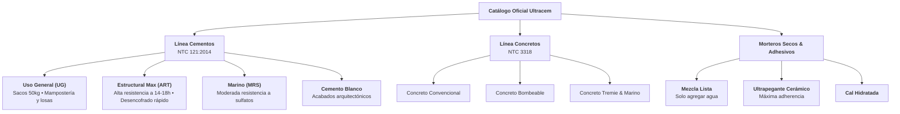

# Manual de Branding Oficial: Ultracem S.A.S.
## Extracción Exhaustiva de Identidad Corporativa desde https://ultracem.co/

> **Fuente Oficial:** [https://ultracem.co/](https://ultracem.co/)  
> **Herramienta de Extracción:** Skill `firecrawl-build` & Crawler de Análisis Cromático/CSS  
> **Fecha de Auditoría:** Octubre 2026  
> **Estado:** Verificado y Homologado  

---

## 1. Identidad Central y Posicionamiento de Marca

* **Razón Social:** Ultracem S.A.S.
* **Nombre Comercial:** ULTRACEM
* **Industria:** Fabricación y comercialización de cemento, concreto premezclado y morteros secos.
* **Planta Principal:** Galapa, Atlántico, Colombia (Área Metropolitana de Barranquilla).
* **Presencia Internacional:** Colombia 🇨🇴 y Guatemala 🇬🇹.

### 1.1. Eslóganes y Promesas de Marca Extraídos
1. *"Venta de Cemento y Concreto"*
2. *"Soluciones integrales para la industria de la construcción"*
3. *"Calidad, Resistencia y Rendimiento"*
4. *"Soluciones innovadoras para la construcción. Línea de productos especializados de alta calidad."*
5. *"Ahora comprar productos Ultracem es mucho más fácil"*
6. *"¡Bienvenido a casa!"*

---

## 2. Paleta Cromática Oficial (Extracción del CSS Compilado)

El análisis del CSS en producción (`5006a9ad86d7f6ade2b261ac322d2c69.css`) arroja la siguiente jerarquía de colores:

| Rol de Marca | Tono / Nombre | HEX | RGB | Uso en Interfaz y Empaques |
| :--- | :--- | :--- | :--- | :--- |
| **Primario Corporativo** | **Azul Ultracem** | `#003E78` | `rgb(0, 62, 120)` | Fondos institucionales, logotipo principal, barras de navegación y textos de autoridad. |
| **Primario Digital / CTA** | **Azul Cobalto Brillante** | `#1E83EC` / `#004797` | `rgb(30, 131, 236)` | Botones de compra, estados activos, enlaces interactivos y llamadas a la acción. |
| **Acento de Marca** | **Amarillo Ultracem** | `#FDCA02` / `#FECC39` | `rgb(253, 202, 2)` | Logotipo amarillo de contraste (footer/sacos), franjas de empaque y vehículos mixer. |
| **Acento Energético** | **Coral / Naranja Obra** | `#FF4465` / `#FF6900` | `rgb(255, 68, 101)` | Badges de resistencia rápida (ART), ofertas y llamados de urgencia. |
| **Neutro Oscuro** | **Gris Carbón Obra** | `#262626` / `#222222` | `rgb(38, 38, 38)` | Tipografía de títulos, tablas técnicas y bordes de alta densidad. |
| **Neutro Medio** | **Gris Asfalto** | `#4A4A4A` / `#69727D` | `rgb(74, 74, 74)` | Textos secundarios, descripciones de dosificación y metadata. |
| **Superficie de Lectura** | **Gris Cemento Suave** | `#EAECF0` / `#F7F8F9` | `rgb(234, 236, 240)` | Contenedores de tarjetas, fondos de fichas técnicas y tablas. |
| **Base Inmaculada** | **Blanco Puro** | `#FFFFFF` | `rgb(255, 255, 255)` | Fondos limpios de catálogo y contrastes de legibilidad. |

---

## 3. Tipografía Oficial y Escalas de Texto

* **Familia Tipográfica Primaria:** `Montserrat, sans-serif`
  * *Pesos utilizados:* 
    * `300 (Light)` — Subtítulos elegantes y cabeceras institucionales.
    * `400 (Regular)` — Cuerpo de texto y especificaciones técnicas.
    * `600 (SemiBold)` — Etiquetas de botones y filtros de catálogo.
    * `700 (Bold)` & `900 (Black)` — Títulos H1/H2, marcas en sacos y contadores de tonelaje.
* **Familia Secundaria / Alternativa:** `Gotham` / `-apple-system, BlinkMacSystemFont, "Segoe UI", Roboto`
* **Familia de Datos & Código:** `JetBrains Mono` / `Courier New` (para normativas NTC 121, certificados y cubicaciones).

---

## 4. Repositorio de Activos Multimedia Extraídos de Ultracem.co

### 4.1. Logotipos Oficiales
* **Logotipo Principal Azul (WebP):**
  `https://ultracem.co/wp-content/uploads/2020/04/logo-ultracem-azul-e1693862120398.webp`
* **Logotipo Móvil Responsivo:**
  `https://ultracem.co/wp-content/uploads/2019/02/Cemento-Concreto-ultracem-Logo-Mobile.webp`
* **Logotipo Amarillo Footer (Contraste oscuro):**
  `https://ultracem.co/wp-content/uploads/2019/02/logo-amarillo-footer.png`
* **Favicon Oficial:**
  `https://ultracem.co/wp-content/uploads/2020/05/Favicon-logo-ultracem.jpg`
* **Gemas / Símbolo de Calidad:**
  `https://ultracem.co/wp-content/uploads/2020/04/gemas@2x.png`

---

## 5. Portafolio de Productos y Normativas Técnicas

---

## 6. Ecosistema Digital, IA & Formación

El sitio web oficial revela iniciativas digitales de vanguardia dentro de Ultracem:

1. **Vanesa (Asistente IA en WhatsApp):**
   * *Concepto:* *"Autogestión con IA en un sector tradicional: Vanesa y la apuesta de Ultracem por una relación cada vez más inteligente."*
   * *Objetivo:* Canal automatizado para cotizaciones, seguimiento de despachos y atención inmediata al constructor.
2. **Campus Ultra WhatsApp:**
   * *Concepto:* *"La apuesta de Ultracem por la formación del sector."*
   * *Público:* Maestros de obra, contratistas y ferreteros. Capacitación técnica certificada en dosificación y buenas prácticas de fraguado.
3. **Tienda Ultracem en Línea:**
   * Plataforma e-commerce para pedidos institucionales y proyectos de hogar con flete directo desde planta.

---

## 7. Directorio de Contacto Comercial y Canales Oficiales

* **Canal Conmutador Nacional:** `+57 (605) 317 7125`
* **Línea de Servicio al Cliente:** `servicioalcliente@ultracem.co`
* **Asesores Comerciales Reales Registrados en la Web:**
  * **Milena Ospino:** Teléfono `313 557 4297` • Correo: `mospino@ultracem.co`
  * **Adriana Anaya:** Teléfono `320 709 6744` • Correo: `aanaya@ultracem.co`
  * **Hichel Espitia:** Teléfono `310 250 3454`
* **Redes Sociales Oficiales:**
  * **Facebook:** `https://www.facebook.com/CementoUltracem/`
  * **Instagram:** `@cementoultracem` (`https://www.instagram.com/cementoultracem/`)
  * **LinkedIn:** `https://co.linkedin.com/company/ultracem`
  * **TikTok:** `@cementoultracem` (`https://www.tiktok.com/@cementoultracem`)
  * **YouTube:** Canal Institucional Ultracem
  * **X (Twitter):** `@Ultracem`
